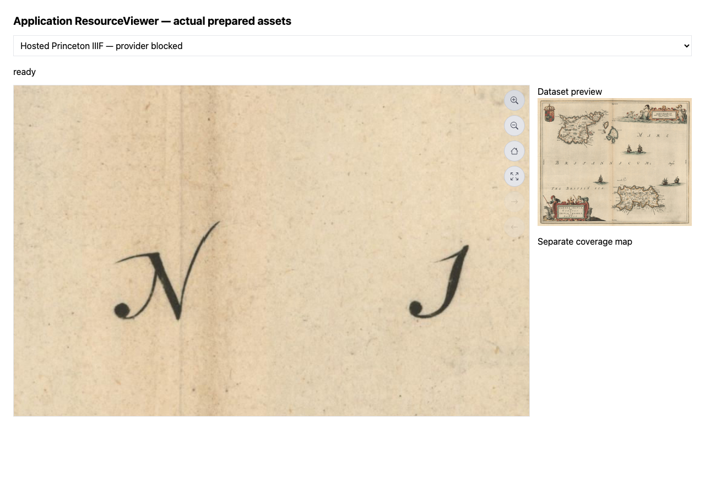

# Hosted IIIF validation supplement

This supplements the original 40-record pilot; it does not change its historical
counts. The implementation is feature-gated and has not been deployed to production.

## Real source outcomes

| Record | Outcome | Evidence |
| --- | --- | --- |
| `princeton-bc386n92s` | Ready | Full-resolution static level 0 image and Presentation manifest; viewer renders and zooms with provider requests blocked |
| `princeton-q237hv16v` | Over limit | Declared dimensions exceed the default 80-million-pixel budget; no incomplete bundle published |

The successful map's provider manifest is available at
[Princeton Figgy](https://figgy.princeton.edu/concern/scanned_maps/c86cd4c1-ac79-4e43-a582-61b4067bb136/manifest).
Its generated Image API 2 info document advertises only generated sizes and tile
scale factors. The full image retains source dimensions. A browser test using the
application ResourceViewer requested five tiles initially and 41 after zooming,
with no provider requests and no page errors. The browser harness fulfilled asset
requests from the real stored output; separate HTTP route tests verify CORS, HEAD,
Range and withdrawal behavior. This is not a deployed CDN test.

## Measured storage and optimization

The same source was processed before and after encoding optimization:

| Measure | Initial encoding | Optimized encoding |
| --- | ---: | ---: |
| Distinct IIIF object bytes | 29,470,206 | 19,736,552 |
| Distinct IIIF objects | 291 | 291 |
| Logical IIIF paths | 293 | 293 |
| Content thumbnail bytes | 398,117 | 189,282 |

The IIIF object reduction is 33.03%; the thumbnail reduction is 52.46%. These are
one-map measurements, not a collection average. Deduplication eliminates duplicate
full-image/size object uploads. JPEG tiles use quality 82, optimized progressive
encoding and 4:4:4 chroma; a smaller full source JPEG is reused verbatim. Palette
quantization of display PNGs is bounded by alpha and RGB-error checks. Numeric
raster/class data are unaffected. Default whole-image dimensions are unchanged.

## Automated coverage and limitations

Tests exercise both Presentation 2 and 3, all advertised tile paths including
partial edge tiles, complete multi-canvas snapshots, unavailable-provider delivery,
manifest withdrawal, dimension mismatch, selector rejection, resource limits,
recipe-version invalidation, palette size reduction and alpha preservation.
Existing raster/vector/service/index tests continue to run.

The bounded subset supports one full-canvas painting image per embedded canvas.
External painting pages, choices, compositing, authentication and nonstandard
orientation require review. Full provider downloads must be available; stitching
provider tiles is not implemented. Annotation/search services and other descriptive
links are preserved but not hosted. Failed refreshes retain the prior published
version. Direct object/CDN serving still needs the documented bundle-path resolver
or export mapping and cache withdrawal handling.

See [the public workflow and limits](shared_preview_assets.md#hosted-iiif-level-0-derivatives).
