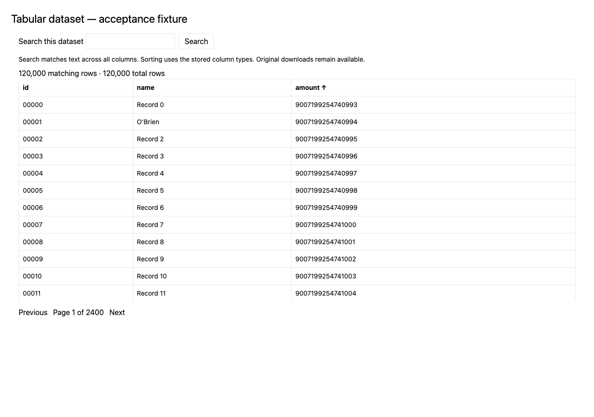

# Tabular preview derivatives

The shared preview worker accepts direct CSV, TSV, and Parquet download URLs
with recognizable file extensions. It publishes a ZSTD-compressed Parquet
layer through the existing access-checked, Range-enabled preview asset route.
No row contents are added to collection-wide search. Original downloads and
harvested metadata remain unchanged.

## Conversion and API

The worker uses pinned DuckDB 1.3.1, one thread, a 512 MB query memory limit,
and the shared processing time, download, temporary storage, and output limits.
Spill files stay in the job directory. Parquet row groups contain 16,384 rows.
No source originals are retained in derivative storage.

CSV/TSV requires UTF-8 text and a header with unique, nonempty column names.
Values remain text, preserving identifiers, leading zeros, and numeric spelling;
empty unquoted fields become null. CSV sorting is consequently lexical.
Parquet retains supported scalar column types, including integers and decimals.
Neither numeric quantization nor geographic inference is applied. Tables with
more than 256 columns, nested/binary columns, or malformed content fail validation.
Spreadsheet workbooks, zipped tables, database connections, and extensionless
URLs are not yet supported by this adapter.

A ready `meta.ui.preview.layers` entry adds:

```json
{
  "id": "table",
  "name": "Data table",
  "format": "parquet",
  "url": "/api/v1/resources/example/preview-assets/<hash>.parquet",
  "columns": [{"name": "identifier", "type": "VARCHAR"}],
  "row_count": 202,
  "byte_size": 24069
}
```

Schema and row count are recorded with the immutable derivative manifest. The
existing eligibility, publication selection, fingerprint refresh, last-valid
retention, and withdrawal gates apply. Table readiness is independent of
thumbnail readiness. A table without an existing content thumbnail retains its
family fallback. Coverage uses existing verified/metadata geometry; column names
such as latitude or longitude alone do not create a map.

## Browser behavior

The resource viewer lazy-loads a same-origin DuckDB WASM worker and module
(pinned package `1.33.1-dev57.0`, the npm `latest` tag at implementation time).
The emitted WASM module is approximately 39 MiB before HTTP compression; it is
loaded only for table previews and should use fingerprinted static-asset caching.
It reads the hosted Parquet using HTTP Range, displays 50 rows per page, and
supports case-insensitive literal substring search across columns and typed
ascending/descending sorting. Search is submitted explicitly. Integers and
decimals are cast to strings for display to avoid JavaScript precision loss.
Nulls display as a dash. Users can select among supplied table layers.

Queries run in a worker with a 256 MB DuckDB query-memory limit. A 30-second
watchdog terminates the worker; Cancel, navigation, and component cleanup also
terminate it. This is a query limit, not a hard browser-process memory ceiling.
Errors display a retry state and retain original-download access. There is no
public arbitrary-SQL endpoint. Search text is escaped as a literal, identifiers
come from the published schema, and React renders cell values as text.

Range support does not make arbitrary text searches free: searches across all
columns and global sorts can read most or all of a file. Each query session is
released afterward, so later queries may read bytes again. Full-download
fallback is disabled. The serving endpoint must provide correct HEAD lengths,
206 responses, Content-Range, Accept-Ranges, and browser CORS headers.

## Local validation

Run backend table tests with the repository test environment and
`tests/preview_assets/test_tabular.py`. Run frontend query tests with
`npx vitest run src/__tests__/utils/tableQuery.test.ts`. Browser acceptance is
`npx playwright test -c playwright.viewer.config.ts table.spec.ts` from
`frontend/`; it tests development and production bundles with a deterministic
120,000-row Parquet fixture. The fixture intentionally includes a leading-zero
identifier, an apostrophe, and an integer above JavaScript's exact-number limit.

A real public USGS daily earthquake CSV was also processed on November 1, 2026:
202 rows, 41,386 source bytes, 24,069 derivative bytes, and 0.877 seconds in the
local run. Source: https://earthquake.usgs.gov/earthquakes/feed/v1.0/summary/all_day.csv.
This changing external feed is supplemental adapter evidence, not a BTAA pilot
record or a collection-wide compression estimate.

## Storage accounting

Add the measured Parquet object sizes for eligible tabular sources, multiplied
by the retained-version policy, to the derivative estimate. Avoid double-counting
identical content-addressed objects. Do not assume every catalog record has a
table or extrapolate the small USGS sample. Browser WASM assets add fixed frontend
storage and initial browser transfer; searches add asset reads and delivery.
Existing collection cost estimates do not yet include a measured tabular census.
Deployment storage and serving procedures belong in restricted operations docs.

## Validation results for this PR extension

- 82 shared-pipeline tests passed, including nine tabular cases and range-aware
  S3-backed HEAD regression assertions. The separate database integration test
  was not rerun for this extension.
- 57 frontend unit/component tests passed, including the resource detail page.
- Browser checks cover partial reads, exact integer rendering, leading zeros,
  literal search, sorting, pagination, unavailable assets, and cancellation.
- Backend lint/format, frontend lint, and the application production build passed;
  frontend lint retains 12 existing warnings.



This screenshot uses the deterministic acceptance fixture, not a catalog record.
